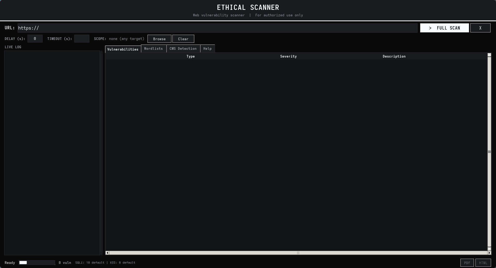
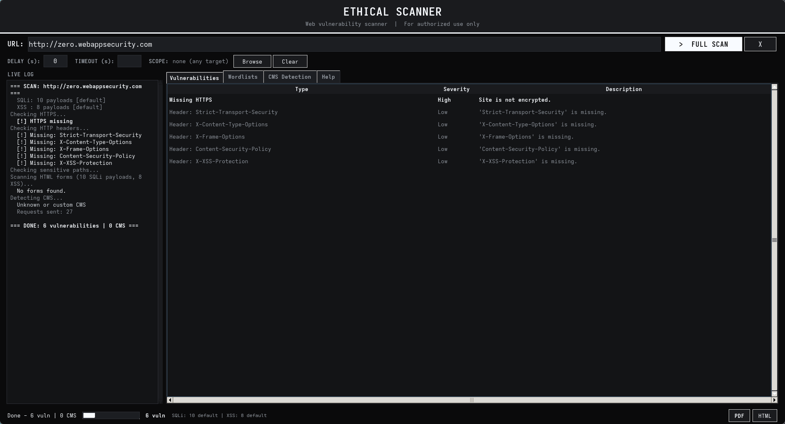
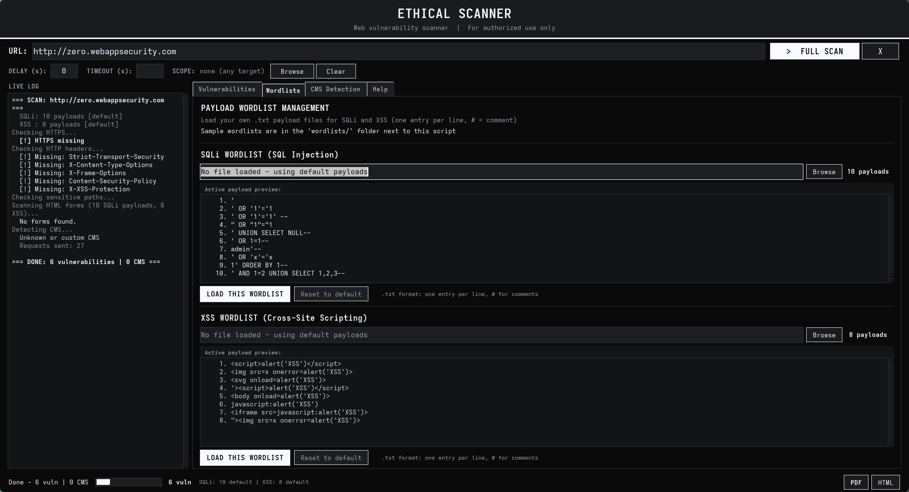
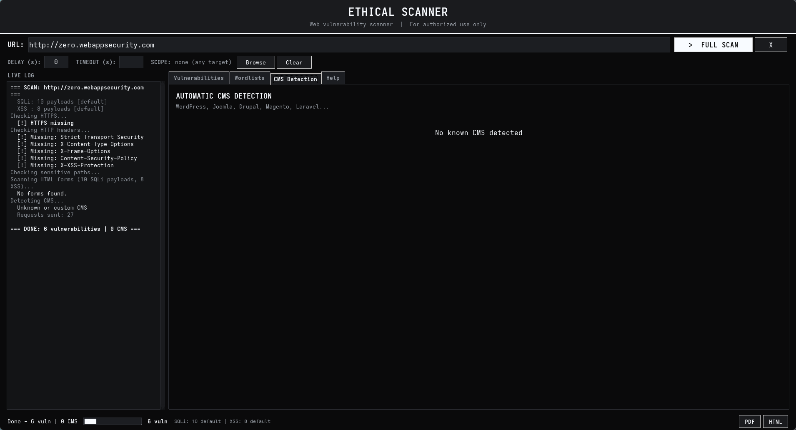

# EthicalScanner

[](https://github.com/0uts1d3r-sec/ethical-scanner/actions/workflows/tests.yml)

## Screenshots

| | |
|---|---|
|  |  |
|  |  |

A desktop web vulnerability scanner with a dark GUI, built with Python and Tkinter. It runs a set of quick, first-pass checks against a target you are authorized to test, lets you plug in your own SQLi / XSS payload wordlists, and exports the findings as an HTML or PDF report.

> **Legal notice.** Only scan systems you own or have **explicit written permission** to test. Unauthorized scanning is illegal in most jurisdictions. You are solely responsible for how you use this tool. The authors accept no liability for misuse or damage.

## Features

| Area | What it does |
|---|---|
| **Transport** | Flags sites served without HTTPS |
| **Security headers** | Checks for `Strict-Transport-Security`, `X-Content-Type-Options`, `X-Frame-Options`, `Content-Security-Policy`, `X-XSS-Protection` |
| **Sensitive paths** | Probes 12 common paths (`/admin`, `/.env`, `/.git`, `/phpmyadmin`, `/wp-config.php`, ...). `200` = exposed, `403` = exists but protected |
| **Form testing** | Finds HTML forms on the target page and injects SQLi / XSS payloads into every field |
| **SQLi detection** | Error-based: matches database error signatures (MySQL, PostgreSQL, SQLite, Oracle, MSSQL) in the response |
| **XSS detection** | Reflected: reports a finding when the injected payload comes back unmodified in the response |
| **CMS fingerprinting** | WordPress, Joomla, Drupal, Magento, Laravel, from paths, headers, cookies and HTML patterns, with a confidence score and hardening tips |
| **Custom wordlists** | Load your own `.txt` payload files for SQLi and XSS, with preview and live counters |
| **Request limits** | Optional delay between requests, request timeout and a scope file that blocks any request leaving the allowed targets, redirects and form actions included (GUI and CLI) |
| **Reports** | One-click HTML and PDF export (PDF requires ReportLab) |

## Installation

Requires **Python 3.10+**. Tkinter is only needed for the GUI; the command-line version works without it.

```bash
git clone https://github.com/0uts1d3r-sec/ethical-scanner.git
cd ethical-scanner

python -m venv .venv
source .venv/bin/activate        # Windows: .venv\Scripts\activate
pip install -r requirements.txt
```

Tkinter ships with the Python installers on Windows and macOS. On Linux, install it from your package manager:

```bash
# Arch / Omarchy
sudo pacman -S tk

# Debian / Ubuntu
sudo apt install python3-tk
```

ReportLab is optional: without it the PDF button is simply hidden and everything else works.

> **Linux note:** use your system Python with Tk (`sudo pacman -S tk` / `sudo apt install python3-tk`). Some prebuilt Python distributions (mise, pyenv, uv) ship a Tk build that renders fonts tiny and pixelated.

## Usage

```bash
python ethical_scanner.py
```

1. Enter the target URL (a missing scheme defaults to `https://`). Optionally set a **delay**, a **timeout** and a **scope file** in the row below it (see [Scope file](#scope-file)).
2. Click **FULL SCAN** and follow progress in the live log.
3. Review findings in the **Vulnerabilities** tab and the **CMS Detection** tab.
4. Export with **HTML** or **PDF** (bottom right). Reports are written to the current directory.

### Custom wordlists

> **Warning:** `sqli_destructive.txt` contains payloads that can modify or delete
> data (e.g. DROP/DELETE). Never use it outside a dedicated test environment
> that you own or are explicitly authorized to test.

Open the **Wordlists** tab:

1. Click **Browse**. The dialog opens in the bundled `wordlists/` folder.
2. Pick a `.txt` file, then click **LOAD THIS WORDLIST**.
3. The bottom bar shows `custom` or `default` for each list. **Reset to default** restores the built-in payloads.

Bundled samples:

| File | Content |
|---|---|
| `wordlists/sqli_samples.txt` | SQL injection payloads (basic, OR, UNION, error, boolean, time-based, WAF bypass) |
| `wordlists/xss_samples.txt` | XSS payloads (script, img, SVG, attribute injection, filter bypass, polyglot) |
| `wordlists/sqli_destructive.txt` | `DROP` / `INSERT` stacked queries. **Modifies data**: lab databases only |

File format:

```text
# Lines starting with # are comments
' OR '1'='1
' UNION SELECT NULL--

<script>alert(1)</script>
```

- One payload per line; blank lines and comments are ignored.
- Lines longer than 500 characters are skipped.
- Good public sources: [SecLists](https://github.com/danielmiessler/SecLists), [PayloadsAllTheThings](https://github.com/swisskyrepo/PayloadsAllTheThings).

> **Keep wordlists non-destructive.** Payloads are sent to live forms, and on a vulnerable target a statement like `'; DROP TABLE users--` really executes. Only `sqli_destructive.txt` contains such statements, so use it exclusively against a disposable lab database (DVWA, a local container, ...).

## Project structure

```text
.
├── ethical_scanner.py        # engine, Tk GUI and report generators
├── ethical_scanner_cli.py    # command-line version (same engine, no Tk needed)
├── scope.example.txt         # example scope file for --scope-file
├── wordlists/
│   ├── sqli_samples.txt
│   ├── sqli_destructive.txt
│   └── xss_samples.txt
├── tests/                    # pytest suite (no internet access needed)
├── docs/                     # screenshots used in this README
├── .github/workflows/        # CI: tests on Python 3.10, 3.12 and 3.14
├── requirements.txt
├── SECURITY.md
├── LICENSE
└── README.md
```

## Command line

A command-line version shares the same engine and does not need Tk:

```bash
python ethical_scanner_cli.py http://localhost:3000 \
  --sqli-wordlist wordlists/sqli_samples.txt \
  --xss-wordlist wordlists/xss_samples.txt \
  -o report.html
```

| Option | What it does |
|---|---|
| `-o FILE` | Save a report; the format comes from the extension (`.json`, `.html`, `.pdf`, `.txt`) |
| `--json` | Print the JSON report on stdout (logs go to stderr) |
| `--fail-on LEVEL` | Exit with code 1 if a finding of that level or higher exists (CI friendly) |
| `-q`, `--no-color` | Hide the live log / disable colors |
| `-y`, `--yes` | Confirm that you are authorized to test the target (otherwise you are asked) |
| `--allow-destructive` | Required to use SQLi payloads that modify or delete data (lab databases only) |
| `--delay SECONDS` | Minimum pause between two requests (rate limit), e.g. `--delay 1` |
| `--timeout SECONDS` | Timeout applied to every request |
| `--scope-file FILE` | Allowed targets: the scan is refused for any other host, and every request that leaves the scope (redirects and form actions included) is blocked |

### Scope file

One entry per line, comments start with `#` (see `scope.example.txt`):

```text
example.com        # this host only
*.example.com      # subdomains only: list the apex separately
10.0.0.0/24        # IP range
```

```bash
python ethical_scanner_cli.py https://app.example.com --scope-file scope.txt --delay 1 --timeout 10
```

## How it works

- `WordlistManager`: loads, validates and resets payload lists.
- `ScanEngine`: runs the checks in a background thread so the UI stays responsive, and reports through callbacks.
- `ScannerApp`: the Tkinter interface.
- `PDFReportGenerator`: builds the PDF report.
- `ethical_scanner_cli.py`: the command-line front end, built on the same engine.
- `RequestPolicy`: wraps every HTTP request, redirects included, to apply the scope file, the delay and the timeout (GUI and CLI).

The scan order is: HTTPS, headers, paths, forms, CMS. For each form field, payloads are tried one at a time and testing stops at the first hit per form and per vulnerability type.

## Limitations

This is a lightweight first-pass tool, not a replacement for Burp Suite, ZAP or sqlmap.

- Scans **only the single URL you provide**: no crawling, so forms on other pages are not tested.
- SQLi detection is **error-based only**. Blind, boolean and time-based injection are not detected.
- XSS detection is string reflection, so it cannot tell whether the payload is actually exploitable in context. Confirm manually.
- Path checks treat any `200` as exposed, so sites with soft-404 pages can produce false positives.
- Requests are sequential and TLS certificate verification is disabled (`verify=False`), so self-signed targets work but certificate problems are not reported.
- No authentication or session handling.

Treat every finding as a lead to verify, not as proof.

## Roadmap ideas

- Crawl same-origin links and test the forms found
- Time-based and boolean SQLi detection
- Threads (requests are sequential today)
- JSON / SARIF export for CI pipelines

## Development

```bash
pip install pytest
python -m pytest -q
```

The tests only talk to a local server, so they need no internet access. They also run in CI on every push.

## License

Released under the [MIT License](LICENSE). The license grants broad reuse rights but does not authorize you to test systems you do not own: see the legal notice at the top.
